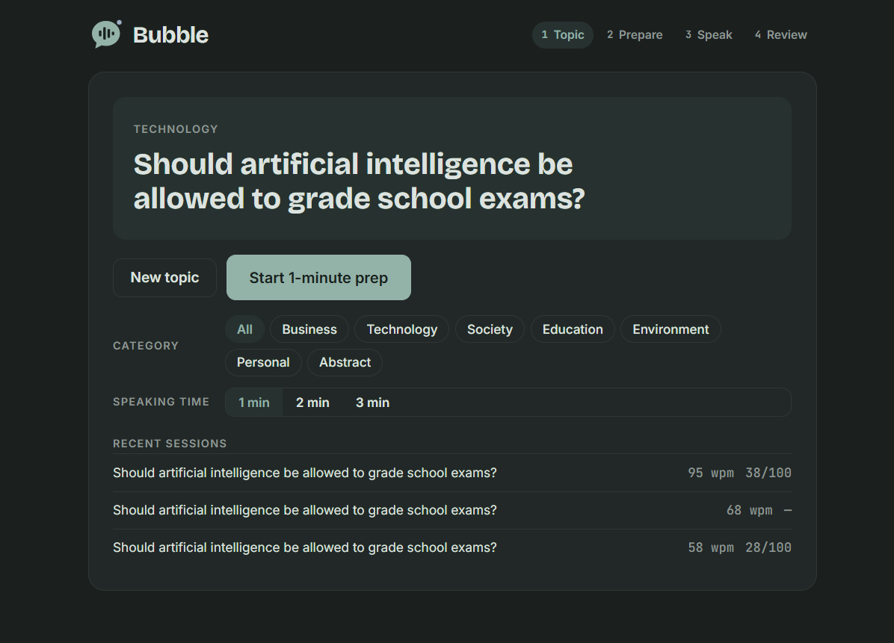
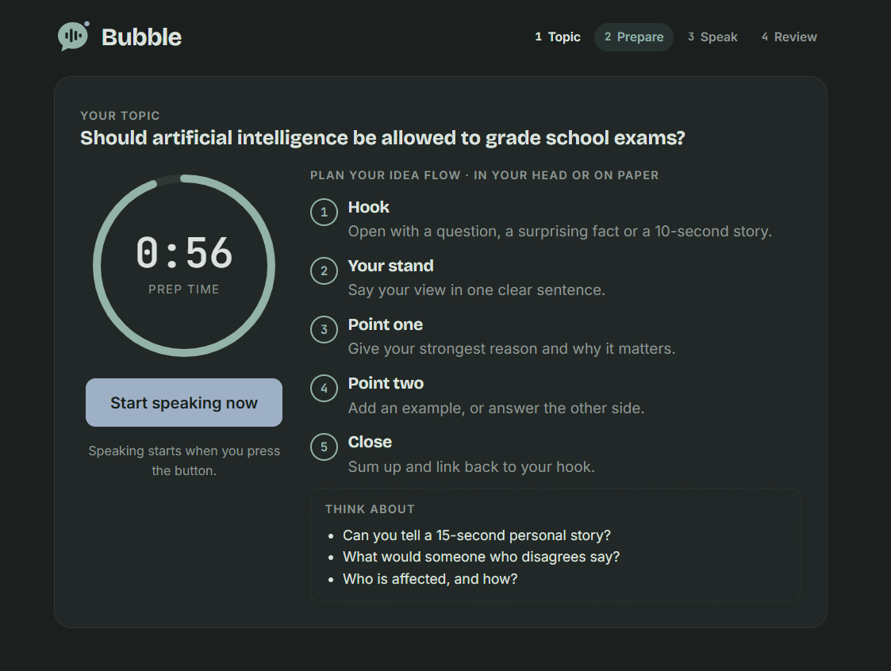
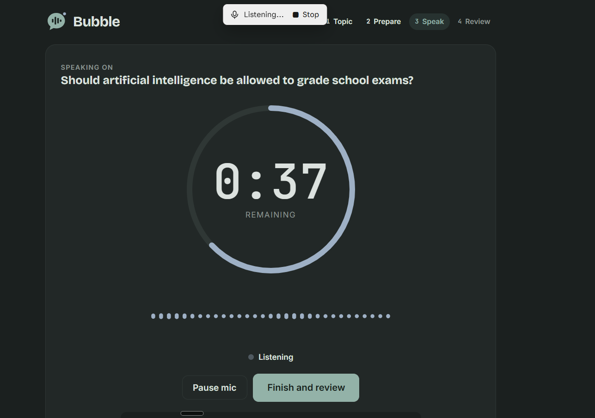
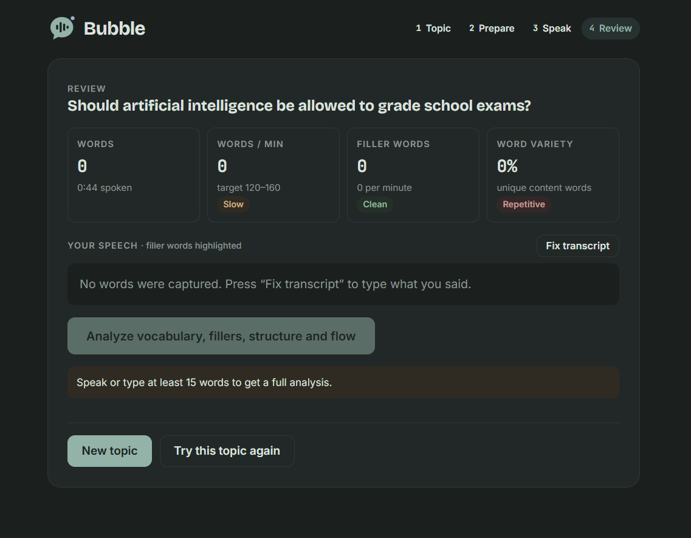

# Bubble

Impromptu speaking practice in one page.

1. **Topic**: pick a category and get a random topic (105 topics across 7 categories).
2. **Prepare**: 60 seconds with a suggested idea flow (hook → stand → point one → point two → close).
3. **Speak**: a big countdown (1, 2 or 3 minutes) with a voice animation while the microphone listens.
4. **Review**: words per minute, filler words, word variety, and Claude's feedback on vocabulary, filler words, structure and flow of ideas.

## Screenshots

| Topic | Prepare |
|---|---|
|  |  |
| **Speak** | **Review** |
|  |  |

## Running it

Everything is in `index.html`.

- **Full app (microphone + Claude feedback):** open the published Claude artifact. Speech capture and the analysis use claude.ai's artifact capabilities (`dictation` and `sample`), so they work only there, in Chrome, Edge or the Claude desktop app.
- **Anywhere else** (opening the file directly, or GitHub Pages): topics, prep, timers and the word statistics work. Type your speech on the review screen instead of speaking it.
